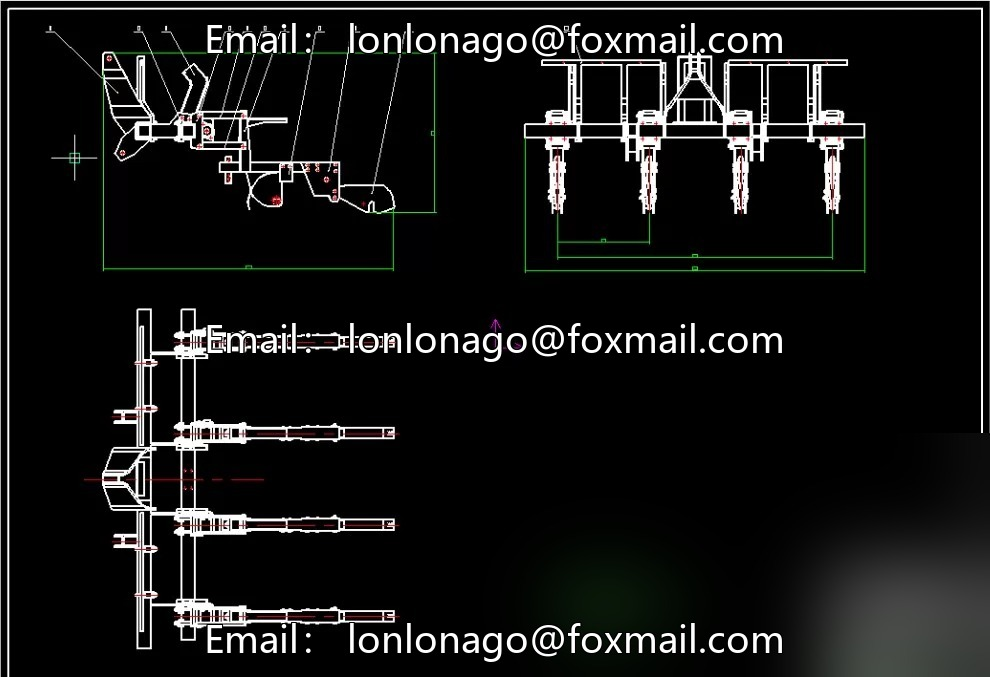
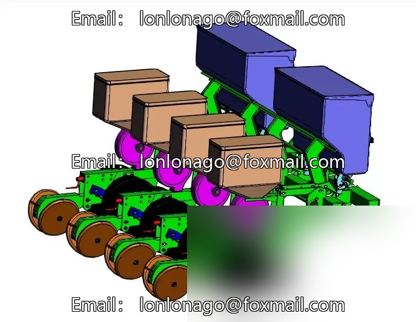

# Soybean seeder design; soybean precise sowing device design; precise sowing device design CAD diagram

## Body

Soybean sowing machine design, soybean precise amount sowing device design diagram, precise amount sowing device design CAD diagram, precise amount sowing device design 3D diagram
Content: CAD diagram + manual + 3D
Applicable to soybean sowing with reference value
551

The design covers soybean sowing machines and precision sowing tools, including CAD drawings, manuals and 3D figures, with reference value for soybean sowing.

<!-- AI_ENRICHED -->

## Images

## Payment

Here is a pay link on Stripe ( https://buy.stripe.com/3cs8yP7sY87d0vu9AB ). Please contact me lonlonago@foxmail.com after funding $89, and I will send you a complete data files , thank you!

